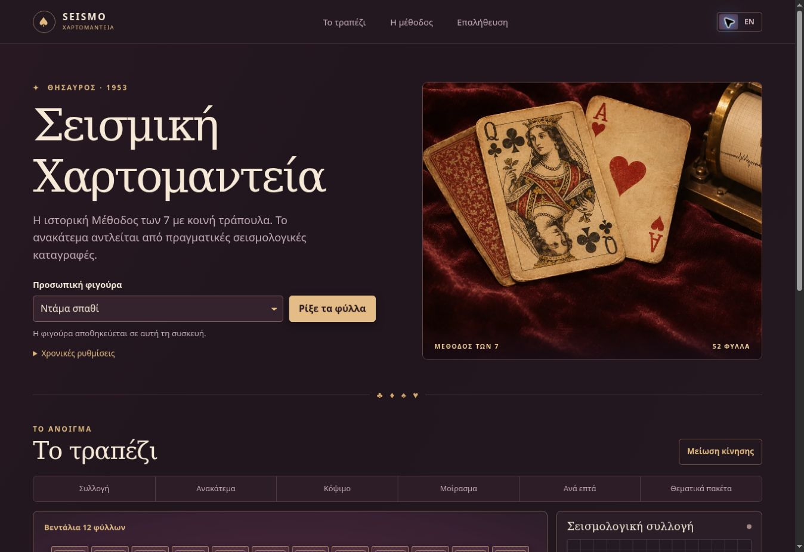
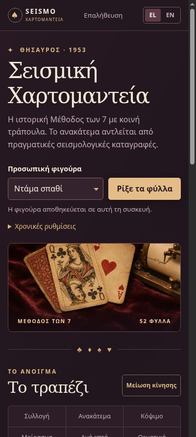

# Σεισμική Χαρτομαντεία · Seismic Cartomancy 1.1.0

Αυτόνομο δίγλωσσο έργο με τη «Μέθοδο των 7» του *Θησαυρού* (30 Αυγούστου 1953, τχ. 770, σ. 26–27). Ο browser συλλέγει πραγματικές καταγραφές από τον πυρήνα του SEISMO και παράγει μια αναπαραγώγιμη ανάγνωση κοινής τράπουλας. Η εφαρμογή είναι πολιτιστική αναπαράσταση για ψυχαγωγία.

A bilingual, static implementation of the *Thesavros* Method of Seven (issue 770, 30 August 1953, pp. 26–27). It reuses the SEISMO waveform collector and computational proof. The application is a historical recreation for entertainment.

**[Επίσημη ιστοσελίδα / Official site](https://dos.gr/seismiki/)** · **[English interface](https://dos.gr/seismiki/en/)**

## Τι κάνει / What it does

- **EL** — Αξιοποιεί πραγματικές σεισμολογικές καταγραφές για να ανακατέψει μια κοινή τράπουλα 52 φύλλων. Ακολουθεί τη «Μέθοδο των 7» του *Θησαυρού* και συνθέτει το «Τι σου λένε τα χαρτιά» με βάση το συγκεκριμένο άνοιγμα. Η εξαγόμενη απόδειξη JSON ελέγχεται ανεξάρτητα.
- **EN** — Uses real seismic recordings to shuffle a standard 52-card deck. The *Thesavros* Method of Seven produces the spread, and the app builds a bilingual narrative from its cards. An independent verifier checks the exported JSON proof.

## Χρήση / Use

Επίλεξε προσωπική φιγούρα μία φορά και πάτησε **Ρίξε τα φύλλα**. Η προεπιλογή δεσμεύει 1 δευτερόλεπτο σεισμικών δειγμάτων και προγραμματίζει την αποκάλυψη 30 δευτερόλεπτα μετά την έναρξη. Η γλώσσα, η φιγούρα και η προτίμηση κίνησης αποθηκεύονται στο browser. Τα δεδομένα του γύρου μένουν στη συνεδρία μέχρι να εξαχθούν σε JSON.

Choose a significator once, then select **Deal the cards**. The default is a 1-second sample window and a 30-second round. Language, significator and motion preference are stored locally. A round stays in the page session until you download its proof.

## Γρήγορη εκκίνηση / Quick start

Extract the installation ZIP directly into an HTTPS directory on a static web server. Browse to that directory's `index.html`. The included `source.zip` is the exact corresponding source and can be downloaded from the application footer.

For local development, unpack the source ZIP and run:

```sh
python3 dev.py
```

Open [http://127.0.0.1:4173/](http://127.0.0.1:4173/). No runtime packages, account, API key, interpretation service or framework build are required. Live mode needs provider connectivity. The verifier can operate locally with an exported bundle and the required recordings.

| Αρχείο / File | Περιεχόμενο / Contents |
|---|---|
| [INSTALL.md](docs/INSTALL.md) | Οδηγίες για cPanel, Apache, Nginx ή τοπική χρήση / Hosting instructions |
| [ALGORITHM.md](docs/ALGORITHM.md) | Χρονικά όρια, αλγόριθμος HMAC, δομή απόδειξης / Timing, HMAC and verification |
| [METHOD.md](docs/METHOD.md) | Ιστορικοί κανόνες και ψηφιακές συμβάσεις / Method and conventions |
| [rules.json](data/rules.json) | 52 ατομικές σημασίες, 72 εγγραφές ζευγών, 39 όμοιες αξίες σε EL/EN |
| [SOURCES.md](docs/SOURCES.md) | Βιβλιογραφία, προέλευση και άδειες / Attribution and licensing |
| [TEST-RESULTS.md](docs/TEST-RESULTS.md) | Αποτελέσματα και αναπαραγωγή δοκιμών / Validation and reproducibility |

Run `npm test` with Node.js 24 or run `node --test tests/*.test.js` directly. Build the install ZIP from this source with `python3 release.py` (Python 3.9+). See the installation guide for packaging and provenance.

## Προέλευση και άδειες / Provenance and licenses

**Ιδέα & δημιουργία / Idea & creation** — Λυκούργος Κεκεμπάνος / Lykourgos Kekempanos · [Lyk.Gr](https://lyk.gr/)

Με τη συνδρομή της τεχνητής νοημοσύνης GPT. / With the assistance of GPT artificial intelligence.

Βασισμένο στον σεισμολογικό μηχανισμό του [SEISMO](https://github.com/dosgr/SEISMO). / Based on the waveform collection and proof engine of [SEISMO](https://github.com/dosgr/SEISMO).

Copyleft 2026 — [GNU AGPL v3](LICENSE) για τον κώδικα / for source code · [CC BY-SA 4.0 International](https://creativecommons.org/licenses/by-sa/4.0/) για το πρωτότυπο περιεχόμενο / for original content. Οι άδειες και οι αναφορές τρίτων καταγράφονται στο [SOURCES.md](docs/SOURCES.md). / See [SOURCES.md](docs/SOURCES.md) for third-party terms and credits.

### Τι νέο υπάρχει στην 1.1.0

Το «Τι σου λένε τα χαρτιά» συνθέτει μια προσωπική, επαληθεύσιμη ανάγνωση σε EL/EN. Διατίθενται αντιγραφή, εκτύπωση, TXT και το μενού κοινοποίησης όπου υποστηρίζεται. Η ελληνική στατική είσοδος είναι η κύρια και η αγγλική βρίσκεται στο πραγματικό `en/`. Η γλώσσα μπορεί να αλλάζει και στον ενεργό γύρο.

- [Μηχανή αφήγησης](docs/NARRATIVE.md)
- [Συμπληρωματικές πηγές](docs/RESEARCH.md)
- [Δίγλωσσα παραδείγματα](docs/EXAMPLES.md)
- [Ιστορικό εκδόσεων](CHANGELOG.md)

## Screenshots

| Υπολογιστής / Desktop | Κινητό / Mobile layout |
|---|---|
|  |  |
