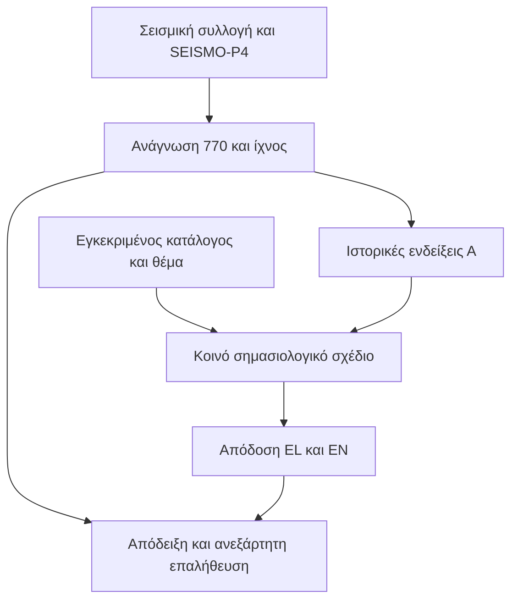

# Historical Cartomancy Knowledge Engine
## Τελική προδιαγραφή για έγκριση

Το HCKE είναι προτεινόμενο επίπεδο ερμηνείας πάνω στο αποτέλεσμα του «Θησαυρού» 770. Στο παρόν πακέτο η 1.1.0 εκτελέστηκε αυτούσια. Τα δείγματα 2.0 είναι επιμελημένα κείμενα με κοινό σημασιολογικό σχέδιο και παραπομπές.

## 1. Σύνορα

Η συλλογή παραμένει σε FDSN Dataselect και SeedLink 4 WSS με τον υφιστάμενο κατάλογο, τα όρια χρόνου και την απαίτηση για επαρκείς ανεξάρτητους σταθμούς. Το SEISMO-P4, τα HMAC-SHA-256 streams, η αμερόληπτη δειγματοληψία, τα κοψίματα, η επιλογή ανά έβδομο, οι εφεδρείες φιγούρας, η επάνοδος και τα τέσσερα πακέτα μένουν στο υπάρχον επίπεδο. Το HCKE δέχεται το αποτέλεσμα μόνο για ανάγνωση. Σε NO_DATA ή NO_FIGURE, διατηρείται η υφιστάμενη κατάσταση και δεν παράγεται αφήγηση.

Η ιστορική βάση διανέμεται αυτοτελώς. Ο browser φορτώνει στατικά τον εγκεκριμένο κατάλογο, τις επιτρεπόμενες σημασιολογικές σχέσεις και τις δύο γλωσσικές αποδόσεις. Η σύνθεση γίνεται τοπικά. Η ερμηνεία δεν χρειάζεται AI API, συνδρομή, βάση στον server ή πρόσθετη χρεώσιμη υπηρεσία. Η ζωντανή συλλογή εξακολουθεί να χρειάζεται τους σημερινούς σεισμολογικούς παρόχους. Η αναπαραγωγή μπορεί να γίνει offline όταν υπάρχουν τα αρχικά τεκμήρια.

## 2. Σχήμα και προέλευση

| Οντότητα | Περιεχόμενο | Προϋπόθεση |
|---|---|---|
| HistoricalAttestation | Αναγνωριστικό, κατηγορία, ιστορική απόδοση EL/EN, έκδοση, σελίδα, συνθήκη | Αυτούσιο αρχείο. |
| Occurrence | Αναγνωριστικό Α, πραγματικές κάρτες, αρχικές θέσεις, στάση και φάση | Προέρχεται από το αρχικό ίχνος. |
| SemanticFacet | Έννοια, θέμα, τόνος, εύρος και αναφορές | Κοινός πυρήνας για ισοδύναμες μαρτυρίες. |
| SemanticLink | Δύο ή τρεις ενεργές όψεις με σχέση | Δηλωμένη εμβέλεια και συνθήκη. |
| EditorialRendering | Σημασιολογικό αναγνωριστικό, κείμενα EL/EN, πηγές, περιορισμοί | Σήμανση Σ. |
| ReadingPlan | Εστίαση, στάσεις, σχέσεις, θέσεις πακέτων και λόγοι επιλογής | Σταθερή σειρά και ακέραια βάρη. |
| ReadingProof | Ίχνος κλήρωσης, θεματική είσοδος, εκδόσεις και αποτυπώματα, πλάνο και κείμενα | Χωριστή επαλήθευση κλήρωσης και αφήγησης. |

Σειρά προτεραιότητας Α, επιβεβαίωση από Β, επιτρεπόμενη εξειδίκευση C και σύγχρονη σύνθεση Σ. Η παλαιά κατηγορία μένει στο ιστορικό αρχείο. Ο πίνακας αξιολόγησης προσθέτει την εκδοτική απόφαση. Η απόφαση διατηρεί ιστορική σελίδα, όρους, ένδειξη Α, λόγο και αναγνωριστικό σύνθεσης. Θεματική ιδέα D/E μπορεί να φωτίσει μόνο όψη που ήδη υποστηρίζεται από ανεξάρτητες ενδείξεις Α.

## 3. Κανόνες σύνθεσης

1. **Ενδείξεις.** Κάθε στάση έχει κέντρο, δύο πραγματικούς γείτονες και τις ενεργοποιήσεις του 770. Κάθε πακέτο διατηρεί τις τρεις ατομικές ενδείξεις και το θεματικό του όνομα. Η επανάληψη αξίας εφαρμόζεται στο ακριβές πλήθος της βεντάλιας.
2. **Ταυτότητα.** Ένα συμμετρικό ζεύγος ταυτοποιείται από φάση, δύο ταξινομημένες φυσικές θέσεις και αναγνωριστικό Α. Η ίδια συνάντηση από δύο στάσεις έχει δύο θέσεις στο ίχνος και ένα αφηγηματικό περιστατικό. Τα P24 και P37 διατηρούν δύο χωριστές σημασίες. Οι μαρτυρίες για κοινό μοτίβο επιβεβαιώνουν την προέλευση, με μηδενικό νέο βάρος.
3. **Τροποποιητές.** Το ακατέργαστο ίχνος 1.1.0 καταγράφει την επαφή του Α♣ και με θετικούς γείτονες. Η προτεινόμενη αφήγηση μαλακώνει μόνο την άμεσα γειτονική ατομική δυσμενή ένδειξη. Το ιστορικό αποτέλεσμα, η δυσκολία και τυχόν ξεχωριστό ζεύγος παραμένουν ορατά.
4. **Κέντρο και τριάδες.** Το φύλλο στο κέντρο ορίζει το θέμα της στάσης. Ρητό ζεύγος εξειδικεύει την αντίστοιχη πλευρά. Μια σύγχρονη τριάδα συνδέει τρεις ήδη στηριγμένες όψεις στην ίδια στάση ή στο ίδιο πακέτο. Οι επιτρεπόμενες σχέσεις περιλαμβάνουν συνύπαρξη, αντίθεση, επαναφορά, τοπική εξειδίκευση και στήριξη. Αιτιότητα μόνο με επαρκή βάση. Οι πλευρές δεν γίνονται χρόνος. Η επάνοδος στη φιγούρα σηματοδοτεί το κλείσιμο της μέτρησης.
5. **Αντιφάσεις.** Για ίδιο αντικείμενο το ειδικό Α προηγείται από το γενικό, π.χ. αναμενόμενη είσπραξη. Δύο διαφορετικές αρμόδιες εκβάσεις διατηρούνται χωρίς συμψηφισμό. Αμφίσημος ιστορικός δράστης μένει απροσδιόριστος. Ευαίσθητες ή παρωχημένες διατυπώσεις μένουν στο τεκμήριο. Η αφήγηση χρησιμοποιεί γενικότερο τεκμηριωμένο τόνο ή παραλείπει το σκέλος. Η φιγούρα δεν αποδίδει πραγματικό φύλο, ηλικία ή εμφάνιση.
6. **Εξειδίκευση.** Η κάρτα ή το Α που τεκμηριώνει την ιδέα πρέπει να έχει ήδη ενεργοποιηθεί στην επιτρεπόμενη εμβέλεια. Πρόσθετα θέματα και συνθήκες ελέγχονται ρητά. Δύο στηριγμοί για θεματική ιδέα D/E ανήκουν στην ίδια επιτρεπόμενη σκηνή ή στο ίδιο πακέτο. Όρος χωρίς υλοποιημένο, δοκιμασμένο έλεγχο μένει εκτός αυτόματης παραγωγής. Άλλη τράπουλα, σειρά, προσανατολισμός ή γεωμετρία παραμένουν στην τεκμηρίωση της προέλευσης.
7. **Αφήγηση.** Προηγείται το ερώτημα που έχει στήριγμα στο άνοιγμα. Επιλέγονται έως τρεις σκηνές, μία ουσιώδης αντίφαση αν υπάρχει και τέσσερα πακέτα στην ιστορική σειρά. Οι πλήρεις ενεργοποιήσεις παραμένουν στην τεκμηρίωση. Η τελευταία παράγραφος επιστρέφει στο ερώτημα και μπορεί να προσθέσει μια τεκμηριωμένη ερώτηση περισυλλογής.

## 4. Είσοδος ερωτήματος

Για την πρώτη υλοποίηση προτείνονται ελεγχόμενες κατηγορίες γενικού ανοίγματος, σχέσεων, εργασίας, χρημάτων, οικογένειας, κοινωνικών σχέσεων, αλλαγών, δυσκολιών, στήριξης και προσωπικού προβληματισμού. Η επιλογή επηρεάζει την εστίαση και τη διατύπωση. Τα φύλλα και οι ιστορικές ενεργοποιήσεις εξαρτώνται από το ήδη υπολογισμένο άνοιγμα. Προαιρετική ελεύθερη σημείωση παραμένει τοπική στη συσκευή και δεν γίνεται είσοδος της σύνθεσης ή της απόδειξης στο πρώτο στάδιο. Στις 30 αναγνώσεις τόσο το πλήρες ερώτημα όσο και η θεματική του κατηγορία ορίστηκαν από επιμελητή. Η αυτόματη κατανόηση ελεύθερου ερωτήματος παραμένει ανοικτό αντικείμενο.

## 5. Αναπαραγωγιμότητα

Για την κατάταξη προτείνεται βάρος 5 για ειδικό ζεύγος, 4 για ακριβές πλήθος, 3 για κέντρο στάσης, 2 για ατομική ένδειξη πακέτου και 2 για τροποποιητή. Το σχετικό θέμα δίνει +2. Οι μαρτυρίες και οι εκδοτικές ενδείξεις δίνουν 0. Σε ισοβαθμία εφαρμόζονται ιστορική ειδίκευση, σειρά φάσης και στάσης ή πακέτου και, τέλος, αλφαριθμητικό αναγνωριστικό σε σειρά ASCII. Η γλώσσα της διεπαφής δεν αλλάζει προτεραιότητες.

Ίδια είσοδος σημαίνει ίδιο P4, πρωτεύουσα φιγούρα, κανόνα, θέμα, πολιτική σύνθεσης, εκδόσεις και λεξικά. Μία σημασιολογική επιλογή τροφοδοτεί και τις δύο γλώσσες. Οι διατυπώσεις αντιστοιχούν ανά κοινό αναγνωριστικό νοήματος. Η επιλογή ισοδύναμης παραλλαγής χρησιμοποιεί σταθερό SHA-256 του κοινού κλειδιού σκηνής και της έκδοσης. Οι γλωσσικές επιλογές δεν επηρεάζουν τις ροές που παράγουν φύλλα. Η ενότητα ανοίγει με επιμελημένη πλήρη φράση και χρησιμοποιεί μικρό σύνολο συνδέσμων ανά σχέση. Η επανάληψη φράσης δίνει την επόμενη επιτρεπόμενη παραλλαγή σε σταθερή σειρά ή οδηγεί σε παράλειψη.

Το νέο αποδεικτικό προτείνεται ως χωριστή έκδοση σχήματος με SHA-256 για κατάλογο, έκδοση μηχανής, φραστικό πακέτο και κοινό πλάνο. Προδιαγράφονται NFC στα επιμελημένα κείμενα, UTF-8, αποκλειστικά ακέραιες αριθμητικές παράμετροι, ταξινόμηση κλειδιών ανά code unit και αμετάβλητη σειρά πινάκων. Η πρώτη επαλήθευση αφορά την παλιά σεισμική αλυσίδα και τα φύλλα. Η δεύτερη αναπαράγει πλάνο και κείμενα με το ακριβές εκδοτικό πακέτο. Απουσία του πακέτου οδηγεί σε χωριστή κατάσταση αφήγησης. Προγενέστερες αποδείξεις ελέγχονται με τον δικό τους κανονικοποιητή και έκδοση.

## English summary

HCKE is a proposed static, local interpretation layer over the verified 770 trace. Historical A triggers are the only source of activations. B evidence supports shared motifs without adding weight. C contributes gated nuances, and D/E may contribute editorial wording only where independent A cues already support it. The engine would plan once, then realise Greek and English through authored language resources. The 30 cases in this package pair genuine 1.1.0 results with editorial 2.0 references for acceptance testing.
